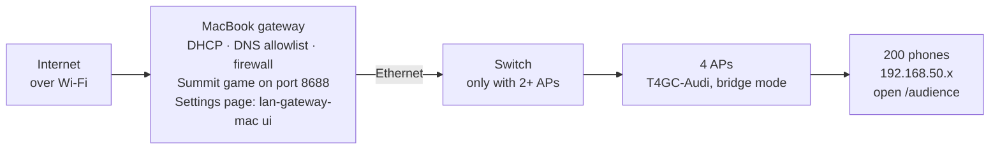

# Summit LAN runbook

Last updated 28 Oct 2026. Editable copy: [Summit LAN runbook](https://claude.ai/artifact/XVPFgdeZipdvyktd6wKUep).

## What this is

A MacBook runs the whole Summit network. It takes internet over Wi-Fi and shares it through an access point called **T4GC-Audi**. Phones can reach only an allowed list of sites, plus the **Summit game** at `http://app.lan`. The Mac's own internet is never filtered.

- **Gateway software:** [summit-lan](https://github.com/praveen902012/summit-lan) (`macos/lan-gateway-mac`). It hands out addresses, answers DNS for allowed sites only, runs the firewall, and offers a settings page.
- **Summit game:** [gamesworkshop](https://github.com/ciaokitty/gamesworkshop), branch `pixel`, cloned to `~/gamesworkshop` and run as a background service on port 8688.
- **Phones** join T4GC-Audi, get an address in `192.168.50.x`, and open `http://192.168.50.1/audience` (or `http://app.lan/audience`).
- **Capacity:** 497 addresses. Plan about 50 phones per access point, so 4 access points for 200 people.



Internet reaches the Mac over Wi-Fi. Everything phones get, from the game to the allowed sites, passes through the Mac.

## What you need

| Item | Detail |
| --- | --- |
| MacBook | macOS, admin password, on its charger all event |
| Internet | A Wi-Fi network the Mac joins (venue Wi-Fi or a phone hotspot) |
| Ethernet adapter | USB-C or Thunderbolt to Ethernet. The Mac's built-in ports aren't Ethernet |
| Access points | Routers set to Access Point / Bridge mode. One per ~50 phones; 4 for 200 |
| Network switch | Only with 2+ access points: Mac → switch → each AP |
| Cables | One Ethernet cable per access point, plus one from the Mac |
| Python 3.8+ | Built into macOS with the Xcode Command Line Tools (`xcode-select --install`), which also provide git |

## One-time setup on the Mac

Do this once, then again only to pick up updates. It takes about 5 minutes.

1. Connect the Mac to the internet Wi-Fi.
2. Plug the Ethernet adapter into the Mac, and its cable into a **LAN** port of the access point (or the switch).
3. Turn off Internet Sharing: System Settings → General → Sharing → Internet Sharing **off**.
4. In Terminal, download the gateway and install it. It asks for your Mac password:

   ```bash
   git clone https://github.com/praveen902012/summit-lan.git ~/summit-lan
   cd ~/summit-lan
   sudo ./macos/lan-gateway-mac install
   ```
5. The installer finds your Wi-Fi and Ethernet ports, sets up DHCP, DNS and the firewall, clones the Summit game into `~/gamesworkshop` (branch `pixel`), and starts both. They start again by themselves after a reboot.
6. Check it: `sudo lan-gateway-mac status` and `sudo lan-gateway-mac app status`.
7. Open the settings page: `lan-gateway-mac ui`.

**To update later:** `cd ~/summit-lan && git pull && sudo ./macos/lan-gateway-mac install`. This keeps the sites and settings you changed on the settings page. Adding `--reset-config` replaces them with the GitHub version.

If the installer says it can't find the Ethernet port, the adapter isn't plugged in or recognised. Unplug and replug it, then run the install again.

## Access point setup

Every access point only broadcasts the Wi-Fi; the Mac does everything else. In each router's admin page:

- **Mode:** Access Point (also called Bridge or AP mode).
- **DHCP server:** off. Two DHCP servers on one network break it.
- **Wi-Fi name:** `T4GC-Audi`, the same name and password on every access point.
- **Channels:** a different one per access point. 5 GHz: 36, 52, 100, 149. 2.4 GHz: 1, 6, 11.
- **Cable:** into a **LAN** port, never the WAN/Internet port.

Check: a phone on T4GC-Audi gets an IP address starting with `192.168.50.` (Wi-Fi settings → T4GC-Audi).

## The Summit game

Summit runs on the Mac as a background service and starts at boot. The host drives it from the Mac; the room joins from phones.

| Who | Opens |
| --- | --- |
| Host, on the Mac | `http://localhost:8688/`, the landing page: Sentences, Rover, Households |
| Audience, on phones | `http://192.168.50.1/audience` or `http://app.lan/audience` |
| Anyone, direct | `http://192.168.50.1:8688/audience` (skips the name and the welcome pop-up) |

Type the full address with `http://`. Phone browsers treat a bare `app.lan` as a search.

| To | Run |
| --- | --- |
| Check it's running | `sudo lan-gateway-mac app status` |
| Start it | `sudo lan-gateway-mac app start` |
| Restart it (clears the live room) | `sudo lan-gateway-mac app restart` |
| Stop it | `sudo lan-gateway-mac app stop` |
| Get the latest game code and restart | `sudo lan-gateway-mac app update` |
| Watch its log (Ctrl+C to stop watching) | `sudo lan-gateway-mac app logs` |
| See the live room (phones, bots, votes) | `curl -s http://192.168.50.1:8688/api/room \| python3 -m json.tool` |

The game's log holds startup lines and errors only. It doesn't log visits or votes, and the live room lives in memory, so a restart clears it. Restart between sessions, never during one.

To run it by hand instead: `sudo lan-gateway-mac app stop`, then `cd ~/gamesworkshop && python3 -B paperweights/room/server.py --port 8688 --bots 5`. On a Mac use `server.py`; `./run-summit.sh` only works on Linux.

## Allowed sites and settings

Change everything on the settings page: run `lan-gateway-mac ui` on the Mac (`sudo lan-gateway-mac ui` if it says permission denied). It only opens on that Mac.

- **Add a site:** type it, like `example.org`, and press Add. Each entry also covers its subdomains.
- **Scan a page:** paste a page address and press Scan. It lists the other sites the page loads (fonts, images, scripts); tick them and press Add selected.
- **Recently blocked:** names phones tried that aren't allowed. Press Allow when a site looks broken.
- **Settings:** number of devices, lease length, Wi-Fi and Ethernet ports, DNS servers, web ports, the Summit address and port, the welcome pop-up.
- **Apply:** changes collect in the bar at the bottom. Nothing changes until you press **Apply changes**; the gateway then restarts in a couple of seconds and phones stay connected.
- **Back up:** Traffic and logs → Download config.env.

The list currently allows idlistack.com, rforum.t4gc.in, tech4goodcommunity.com, accessibilitywheel.netlify.app, idli-tech.vercel.app and the Summit event page. It also allows the files those sites need and the phones' internet-check addresses. Allowing `www.google.com` (an Android check) means Google Search works; the rest of Google stays blocked. The full list is in [config.env](config.env).

## How phones join

Use the two-QR sign until the welcome pop-up has been tested on real phones at the venue.

**The two-QR sign (works today).**
1. Open the [T4GC-Audi Join Sign](https://claude.ai/artifact/E5TK3pCAb6TQetHEGHpqGg) and type the Wi-Fi password into it.
2. Choose `http://192.168.50.1/audience` for code 2. It works even on phones that ignore `app.lan`.
3. Press Show sign full screen for the projector.

Code 1 joins T4GC-Audi; code 2 opens the audience page. The page can't print; take a screenshot (Cmd+Shift+4) to print it.

**The welcome pop-up (one QR code, still being tested).** Settings page → Summit app → Welcome pop-up when phones join. New phones then show a welcome page with a Join the session button that opens the audience page.

- **iPhone:** the page pops up a few seconds after joining.
- **Android:** a notification, Sign in to Wi-Fi network; tapping it opens the page.
- **Button page:** set it to `/audience`.
- **Before tapping:** the phone has no internet, and with mobile data on its normal browser uses mobile data. People must use the pop-up or the notification.
- **If it misbehaves:** untick the pop-up and press Apply changes to return to the normal setup.

A phone that joined T4GC-Audi before a change may remember the old result. Forget the network and join again.

## Event-day checklist

If the Mac sleeps, phones lose the game and the internet, so keeping it awake is the first job.

**An hour before doors**

- [ ] Mac on its charger, joined to the internet Wi-Fi
- [ ] Access points powered, cabled to the switch or the Mac's adapter
- [ ] Keep the Mac awake: run `caffeinate -is` in a Terminal window and leave it open. With the lid closed, use `sudo pmset -c disablesleep 1` instead
- [ ] `sudo lan-gateway-mac status`: cable connected, firewall enabled
- [ ] `sudo lan-gateway-mac app status`: Summit RUNNING
- [ ] Get the latest game code if needed: `sudo lan-gateway-mac app update`
- [ ] Test phone with mobile data on: join T4GC-Audi, open `http://192.168.50.1/audience`
- [ ] One Android and one iPhone tested, if possible
- [ ] Sign on the projector (full screen) or printed at the door

**During the session**

- [ ] Host screen open at `http://localhost:8688/` on the Mac
- [ ] Settings page open, watching Recently blocked for any site people need
- [ ] Don't restart the game mid-session; it clears the live room

**After**

- [ ] Stop `caffeinate` (Ctrl+C), or undo `sudo pmset -c disablesleep 0`
- [ ] Optional: `sudo lan-gateway-mac app stop`
- [ ] To remove everything: `sudo lan-gateway-mac uninstall`

## Troubleshooting

Start with the direct address `http://192.168.50.1:8688/audience` on a phone with mobile data off. If it opens, the game is fine, and the problem is the name, the pop-up or mobile data.

| Symptom | Likely cause | Fix |
| --- | --- | --- |
| Nothing opens on any phone | Summit stopped, or the Mac slept | `sudo lan-gateway-mac app start`; keep the Mac awake |
| App status says STOPPED | It was stopped or never loaded | `sudo lan-gateway-mac app start` |
| Works only with mobile data off | Phone thinks the Wi-Fi has no internet | Forget T4GC-Audi and rejoin; check the internet-check sites are on the list |
| `app.lan` fails, the IP address works | Phone uses its own DNS (Android Private DNS, iCloud Private Relay, Chrome secure DNS) | Use `http://192.168.50.1/audience`, or turn that setting off |
| Typing `app.lan` runs a search | Browser doesn't know `.lan` | Type `http://app.lan/audience` |
| Android says No internet | Its internet check is blocked | Check www.google.com is allowed, then forget and rejoin |
| Welcome pop-up doesn't appear | Pop-up off, or the phone remembered the network | Settings page → tick the pop-up → Apply; forget and rejoin |
| A site loads half-broken | It needs files from other sites | Settings page → Scan the page, or Allow from Recently blocked |
| Settings say Not applied | A value is invalid; the message says which | Fix that field and apply again |
| Installer can't find Ethernet | Adapter unplugged or not recognised | Replug it, run install again |

**Information to send for help:** `tail -40 /var/log/lan-gateway.log`, `sudo lan-gateway-mac status`, `sudo lan-gateway-mac app status`, and the phone model.

## Command reference

| Command | What it does |
| --- | --- |
| `sudo ./macos/lan-gateway-mac install` | Install or update (run in `~/summit-lan`); keeps your settings |
| `sudo ./macos/lan-gateway-mac install --reset-config` | Install with the GitHub site list, replacing your settings |
| `lan-gateway-mac ui` | Open the settings page |
| `sudo lan-gateway-mac status` | Cable, devices, allowed addresses, blocked names |
| `sudo lan-gateway-mac check example.org` | Is this site allowed? |
| `sudo lan-gateway-mac reload` | Re-apply the saved settings |
| `sudo lan-gateway-mac app status` / `start` / `restart` / `stop` / `update` / `logs` | Control the Summit game |
| `tail -f /var/log/lan-gateway.log` | Live gateway log: ALLOW, REFUSED, PORTAL lines |
| `sudo lan-gateway-mac uninstall` | Remove everything and restore normal networking; keeps `~/gamesworkshop` |

| File | Holds |
| --- | --- |
| `/usr/local/etc/lan-gateway/config.env` | Your settings and allowed sites |
| `/var/log/lan-gateway.log` | Gateway log |
| `~/Library/Logs/lan-gateway-app.log` | Summit game log |
| `~/gamesworkshop` | Summit game code (branch `pixel`) |
| `~/summit-lan` | Gateway code |
